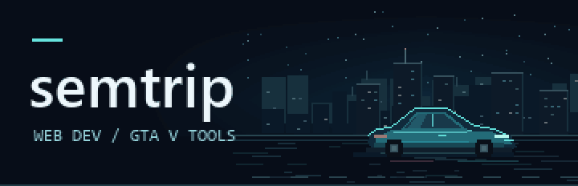

  

  Web developer working on <a href="https://github.com/epic-gta5">EPIC RP</a> and tools for GTA V. 
  <a href="https://t.me/semtrip">Telegram</a>

<h3 align="center">Tech stack</h3>

  
   
  

### Projects

- [gta-clothes-pack](https://github.com/semtrip/gta-clothes-pack) — Python CLI for organizing and packaging GTA V clothing assets.
- [rpf-parser](https://github.com/semtrip/rpf-parser) — TypeScript tooling for packaging GTA V map mods into RPF archives.
- [houseSystemRageMP](https://github.com/semtrip/houseSystemRageMP) — housing system for RAGE Multiplayer.
