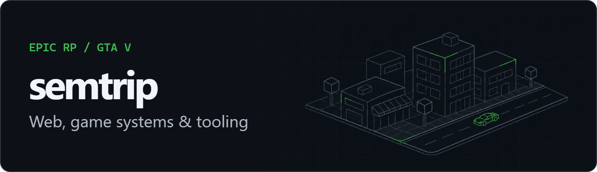

<picture>
  <source media="(prefers-color-scheme: dark)" srcset="assets/profile-dark.png">
  <source media="(prefers-color-scheme: light)" srcset="assets/profile-light.png">
  
</picture>

I build multiplayer game systems, web apps, and developer tools.

## EPIC RP

GTA V roleplay with in-game interfaces, a web platform, and a desktop launcher. I work across gameplay systems, backend services, and tools for building and packaging game content.

[Project website](https://epic-gta.com/) · [GitHub organization](https://github.com/epic-gta5) · [Telegram](https://t.me/semtrip)

## Tech stack

  
   
  
   
  

<strong>Frontend &amp; design</strong>

- HTML, CSS, SCSS, Tailwind CSS, PostCSS
- JavaScript, TypeScript, React, Next.js, React Router
- MobX, Redux Toolkit, React Redux
- Figma, Framer Motion, Radix UI, Floating UI, dnd kit, Lucide
- Leaflet, React Leaflet, Leaflet-Geoman, Recharts

<strong>Backend &amp; APIs</strong>

- Node.js, NestJS, Express, AdonisJS
- Python, FastAPI, Django, Flask, aiohttp
- Go, Kotlin, C#, .NET
- Zod, OpenAPI, Swagger UI, REST, JWT
- Pino, Nodemailer, Node-Cron, Axios

<strong>Real-time, collaboration &amp; integrations</strong>

- WebSockets, Yjs, Hocuspocus, Tiptap, ProseMirror
- Serwist, service workers, Web Push
- Discord.js, Discord Rich Presence, Twitch integrations
- Model Context Protocol (MCP), ExcelJS, React-PDF

<strong>Databases</strong>

- SQL, PostgreSQL, SQLite, Redis, MongoDB
- Mongoose, ioredis, SQLAlchemy, psycopg2, asyncpg
- Entity Framework Core, Npgsql

<strong>Game development &amp; desktop</strong>

- GTA V, FiveM, RAGE Multiplayer, Lua, C++
- Chromium Embedded Framework (CEF), FiveM NUI, Three.js
- Electron, electron-builder, Windows Forms, Win32
- CodeWalker, OpenIV, fivefury, RPF packaging, YDD/YTD assets

<strong>Python &amp; media tooling</strong>

- Pillow, NumPy, PyInstaller
- Sharp, Streamlink, yt-dlp

<strong>Testing &amp; code quality</strong>

- Playwright, Vitest, Testing Library, Supertest, jsdom
- Selenium WebDriver, Puppeteer Sharp
- ESLint, Prettier, Spectral, Madge

<strong>Build &amp; infrastructure</strong>

- Git, GitHub Actions, npm, pnpm, Yarn
- Vite, webpack, esbuild, Turborepo
- Docker, Docker Compose, Nginx, Cloudflare, Linux, PowerShell
- AWS S3, Amazon CloudFront, Prometheus, Grafana Pyroscope

## Selected projects

- [gta-clothes-pack](https://github.com/semtrip/gta-clothes-pack) — Python CLI for organizing and packaging GTA V clothing assets.
- [rpf-parser](https://github.com/semtrip/rpf-parser) — TypeScript tooling for packaging GTA V map mods into RPF archives.
- [houseSystemRageMP](https://github.com/semtrip/houseSystemRageMP) — housing system for RAGE Multiplayer.
